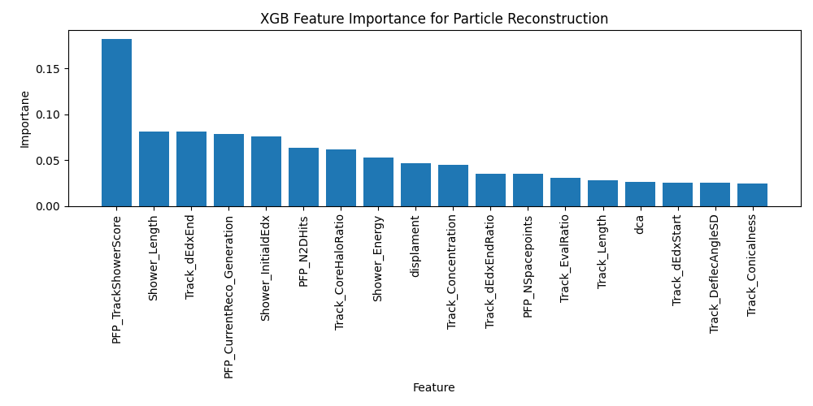
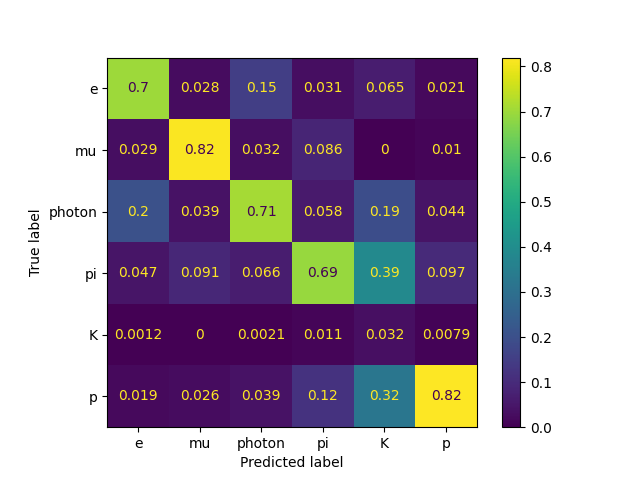
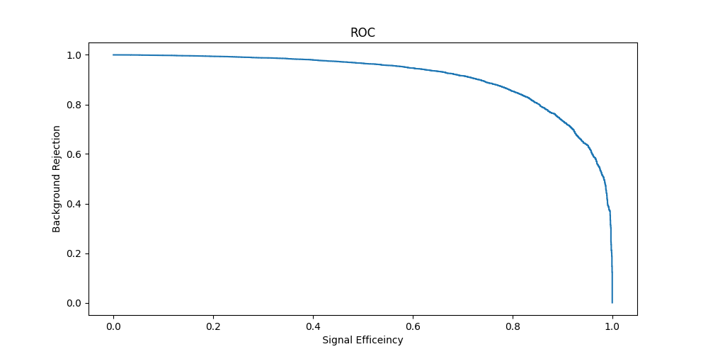
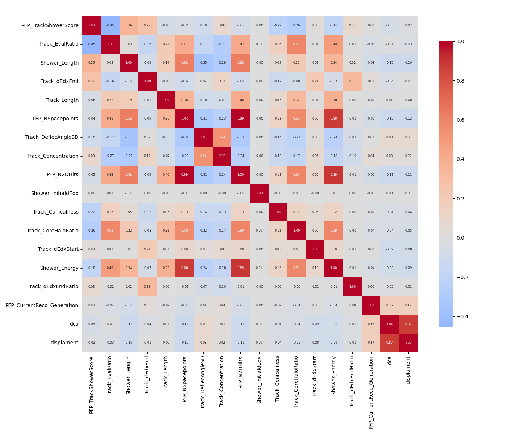

# Dune-LArTPC-
This is repo contains all my work from my experimental particle physics group internship under the supervision of isobel mawby and thomas jones.

# DUNE Particle Identification

## DUNE

The DUNE simulation and reconstruction chain has four main stages: Generation, Geant4 propagation, detector simulation, and reconstruction [1]. The Generation stage is where a generator takes an incoming neutrino's properties (energy, direction), and uses physics models and all possible interactions and their probabilities to pick one interaction and output the particles produced, with their energies and directions. This is followed by the Geant4 ("G4") propagation stage, which propagates those particles through the detector, tracking how far each travels, where it interacts, what secondaries it produces, and the ionisation electrons created along the way. The detector simulation then turns the arriving ionisation electrons into the electrical signal on each wire. The detector records charge on the wires as electrical waveforms (roughly Gaussian on the collection plane, bipolar on the induction planes), together with the scintillation light collected by the photon detectors. The final stage is then the Reconstruction. This recovers physics quantities from those signals. Reco1 turns waveforms into hits where each hit carries a wire position and a drift time from the trigger, so wire $\times$ time gives a 2D event view. Reco2 runs pattern recognition to group hits into objects. PID then assigns each object a particle type. However, this is difficult as a drifting electron induces charge on neighbouring wires too, on top of electronic noise. Because generation and G4 record the true particle behind every hit, the simulation yields a truth label for each reconstructed object, which we use to develop and tune the reconstruction algorithms until their predictions are acceptable. The reconstructed quantities are the physics variables inferred from the detector signals before any decision about which particle produced them. The identified particle is what PID predicts from the reconstructed quantities. In short, we run a Monte Carlo simulation to predict what interactions look like in the detector, tune reconstruction on the truth labels, and then trust that the simulation reflects reality closely enough that the same algorithms work on real data. The identical chain runs on real data except data enters at Reco1, because the waveforms are measured from a real interaction, not simulated.

## PID Methods

In machine learning the main steps are: defining the truth, in particular what counts as signal versus background; constructing the network inputs; choosing the network architecture; iteratively reconfiguring the network based on its performance; and finally assessing performance on unseen data. This last point requires splitting the data into three sets. The network learns from the training set: this is where the weights are fit. The validation set is never used for a gradient step; instead it gauges performance after each training cycle, guiding hand-tuned choices such as architecture and hyperparameters and exposing overfitting. Because those choices are tuned to it, the validation set is no longer an unbiased measure of true performance, so the test set is held back and examined only once, after all training and tuning are complete.

### Gradient Boosted Decision Trees

Decision trees classify the input into regions and then solve each region with a simpler model. The tree is trained by taking all the features of the system, comparing their separating power, and finding the best split; this is repeated recursively until a stopping criterion is reached. There is only one node at the beginning; adding a node turns a leaf into a decision node with two new leaves:

$$
\text{leaf} \longrightarrow \text{decision node} + 2\ \text{leaves}.
$$

Training data is sorted into the tree leaves, and the goal of training is to find the most consistent leaves for the prediction. To evaluate new data, you follow the branching rules until you reach a leaf, then output a prediction based on which training data items are in that leaf. The advantages of the decision tree are that it requires no data pre-processing. It offers a very straightforward interpretation of the decision, and it is nonlinear, meaning it is capable of learning complex correlations. Its limitations are that its decision boundaries are axis-aligned boxes, so it can struggle to capture linear or diagonal behaviour; and that it is a high-variance model (small changes in the data can induce large variations in structure). Trees deep enough to capture complex structure will also fit noise and outliers, whereas shallow trees underfit.

Boosting combines several weak learners into one powerful model that is trained iteratively. The trees are built sequentially, each one trained to correct the errors left by the trees before it. The final prediction is a weighted combination of all of them.

The specific weighting and error-correction rule are what distinguish the variants below. A BDT decision $F$ is a series of decision trees, each depending on a set of parameters $a_m$:

$$
F(x) = \sum_m f_m(x; a_m).
$$

At each step of the boosting procedure, when we add a new tree $f_m$ to the series, we optimise its parameters $a_m$ so as to minimise the loss.

We generalise the classification problem as a minimisation problem. The target is to minimise the loss function $L$, a function that encodes how far the prediction is from the target. We can determine how to optimally grow each tree by using the gradient boosting method [2]. The gradient

$$
\nabla f = \left( \frac{\partial f}{\partial x_1}, \frac{\partial f}{\partial x_2}, \dots, \frac{\partial f}{\partial x_n} \right)
$$

gives the direction and magnitude of the maximal change in a function $f$. If we follow the opposite of this direction we reach the minimum as quickly as possible. The choice of the step during the descent (the learning rate) is a compromise: too small, and convergence is very slow; too big, and there is no convergence, jumping around the minimum.

At each step $n$ we fix the tree structure learned up to step $n-1$, compute the gradient of the loss, train a new tree on the negative gradient $-g_m$, and add the $n$th tree to the sequence with a weight given by the learning rate. The gradient of the loss at the $m$th iteration is

$$
g_m = \left[\frac{\partial L(F, y)}{\partial F(x)}\right]_{F = F_{m-1}}.
$$

We train a tree to learn $-g_m$ and add it to the list with a weight $\eta$ (the learning rate). The tree $t_m$ is expected to learn $-g_m$ as well as possible:

$$
F_m = F_{m-1} + t_m = F_{m-1} - \eta_m\, g_m.
$$

The central advantage of this method is the freedom to choose the loss function $L$. One particular choice recovers an older, more restrictive boosting algorithm: taking the exponential loss

$$
L(F, y) = \exp\!\left(-F(x)\,y\right)
$$

reduces gradient boosting to AdaBoost [3]. AdaBoost is therefore a special case, locked to a single loss that is sensitive to outliers. Gradient boosting lifts this restriction, letting us select a loss that is more robust. Standard choices include

$$
\text{Mean squared error:}\qquad L(F,y) = \tfrac{1}{2}\left(y - F(x)\right)^2,
$$

$$
\text{Binomial log-likelihood loss:}\qquad L(F,y) = \ln\!\left(1 + e^{-2\,y\,F(x)}\right),
$$

and the Huber loss, which switches from a quadratic to a linear error as the error grows, making it robust against outliers:

$$
L_\delta(y, F) =
\begin{cases}
\tfrac{1}{2}\left(y - F\right)^2 & \text{for } |y - F| \le \delta, \\
\delta\left(|y - F| - \tfrac{1}{2}\delta\right) & \text{for } |y - F| > \delta.
\end{cases}
$$

### XGBoost

The **model** in supervised learning usually refers to the mathematical structure by which the prediction $\hat{y}_i$ is made from the input $x_i$ [4, 5]. A common example is a linear model, where the prediction is a linear combination of weighted input features:

$$
\hat{y}_i = \sum_j \theta_j x_{ij}.
$$

The **parameters** are the undetermined part that we need to learn from data. In linear regression problems the parameters are the coefficients $\theta$. The objective function consists of two parts, a training loss and a regularisation term:

$$
\mathrm{obj}(\theta) = L(\theta) + \Omega(\theta),
$$

where $L$ is the training loss (measuring how predictive the model is on the training data, e.g. the mean squared error or logistic loss introduced above) and $\Omega(\theta)$ is the total regularisation term, which controls model complexity and helps avoid overfitting. XGBoost instantiates this objective with a specific model (tree ensembles), a specific regulariser, and a second-order optimisation step. Just like a normal BDT, XGBoost is an ensemble of trees:

$$
\hat{y}_i = \sum_{k=1}^{K} f_k(x_i), \qquad f_k \in \mathcal{F},
$$

where $K$ is the number of trees, $f_k$ is a function in the functional space $\mathcal{F}$, and $\mathcal{F}$ is the set of all possible classification and regression trees (CARTs). The objective to be optimised is

$$
\mathrm{obj}(\theta) = \sum_i^n l(y_i, \hat{y}_i) + \sum_{k=1}^{K} \omega(f_k),
$$

so the total regularisation is $\Omega(\theta) = \sum_{k=1}^{K} \omega(f_k)$, where $\omega(f_k)$ is the complexity of a single tree $f_k$ (defined below). Each training step adds one new tree, so that at step $t$ the ensemble contains $K = t$ trees. The parameters we need to learn are the functions $f_k$, each containing the structure of the tree and the leaf scores. Learning the tree structure is much harder than a traditional optimisation problem where you can simply take the gradient, and it is intractable to learn all the trees at once. Instead, we use an additive strategy: fix what we have learned, and add one new tree at a time. Writing the prediction value at step $t$ as $\hat{y}_i^{(t)}$,

$$
\begin{aligned}
\hat{y}_i^{(0)} &= 0, \\
\hat{y}_i^{(1)} &= f_1(x_i) = \hat{y}_i^{(0)} + f_1(x_i), \\
\hat{y}_i^{(2)} &= f_1(x_i) + f_2(x_i) = \hat{y}_i^{(1)} + f_2(x_i), \\
&\;\;\vdots \\
\hat{y}_i^{(t)} &= \sum_{k=1}^{t} f_k(x_i) = \hat{y}_i^{(t-1)} + f_t(x_i).
\end{aligned}
$$

At each step we add the tree that minimises our objective:

$$
\begin{aligned}
\mathrm{obj}^{(t)}
&= \sum_{i=1}^{n} l\!\left(y_i, \hat{y}_i^{(t)}\right) + \sum_{k=1}^{t} \omega(f_k) \\
&= \sum_{i=1}^{n} l\!\left(y_i, \hat{y}_i^{(t-1)} + f_t(x_i)\right) + \omega(f_t) + \mathrm{constant}.
\end{aligned}
$$

If we consider using the mean squared error as our loss function, the objective becomes

$$
\begin{aligned}
\mathrm{obj}^{(t)}
&= \sum_{i=1}^{n} \tfrac{1}{2}\left(y_i - \left(\hat{y}_i^{(t-1)} + f_t(x_i)\right)\right)^2 + \sum_{k=1}^{t} \omega(f_k) \\
&= \sum_{i=1}^{n} \left[ \left(\hat{y}_i^{(t-1)} - y_i\right) f_t(x_i) + \tfrac{1}{2} f_t(x_i)^2 \right] + \omega(f_t) + \mathrm{constant}.
\end{aligned}
$$

In general we can also take the Taylor series of the loss function up to second order,

$$
\mathrm{obj}^{(t)} = \sum_{i=1}^{n} \left[ l\!\left(y_i, \hat{y}_i^{(t-1)}\right) + g_i\, f_t(x_i) + \tfrac{1}{2} h_i\, f_t^2(x_i) \right] + \omega(f_t) + \mathrm{constant},
$$

where $g_i$ and $h_i$ are defined as

$$
g_i = \partial_{\hat{y}_i^{(t-1)}}\, l\!\left(y_i, \hat{y}_i^{(t-1)}\right), \qquad
h_i = \partial_{\hat{y}_i^{(t-1)}}^{2}\, l\!\left(y_i, \hat{y}_i^{(t-1)}\right).
$$

After removing all the constants, the specific objective at step $t$ becomes

$$
\sum_{i=1}^{n} \left[ g_i\, f_t(x_i) + \tfrac{1}{2} h_i\, f_t^2(x_i) \right] + \omega(f_t).
$$

The main advantage of this is that the objective now only depends on $g_i$ and $h_i$. This is how XGBoost supports custom loss functions: we can optimise every loss function, including logistic regression and pairwise ranking, using exactly the same solver that takes $g_i$ and $h_i$ as input.

We must define the complexity of the tree $\omega(f)$. To do so, we refine the definition of the tree $f(x)$ as

$$
f_t(x) = w_{q(x)}, \qquad w \in \mathbb{R}^{T}, \qquad q : \mathbb{R}^{d} \rightarrow \{1, 2, \dots, T\}.
$$

Here $w$ is the vector of scores on the leaves, $q$ is a function assigning each data point to the corresponding leaf, and $T$ is the number of leaves. In XGBoost we define the complexity as

$$
\omega(f) = \gamma T + \frac{1}{2}\lambda \sum_{j=1}^{T} w_j^2,
$$

where $\gamma$ penalises the number of leaves and $\lambda$ penalises the squared leaf scores. More often than not, this regularisation is overlooked in other tree packages.

### The Structure Score

After reformulating the tree model, we can write the objective value with the $t$-th tree as

$$
\begin{aligned}
\mathrm{obj}^{(t)}
&\approx \sum_{i=1}^{n} \left[ g_i\, w_{q(x_i)} + \tfrac{1}{2} h_i\, w_{q(x_i)}^2 \right] + \gamma T + \frac{1}{2}\lambda \sum_{j=1}^{T} w_j^2 \\
&= \sum_{j=1}^{T} \left[ \left(\sum_{i \in I_j} g_i\right) w_j + \tfrac{1}{2}\left(\sum_{i \in I_j} h_i + \lambda\right) w_j^2 \right] + \gamma T,
\end{aligned}
$$

where $I_j = \{\, i \mid q(x_i) = j \,\}$ is the set of indices of data points assigned to the $j$-th leaf. Defining $G_j = \sum_{i \in I_j} g_i$ and $H_j = \sum_{i \in I_j} h_i$, this compresses to

$$
\mathrm{obj}^{(t)} = \sum_{j=1}^{T} \left[ G_j w_j + \tfrac{1}{2}\left(H_j + \lambda\right) w_j^2 \right] + \gamma T.
$$

The $w_j$ are independent of one another, and each term $G_j w_j + \tfrac{1}{2}(H_j + \lambda) w_j^2$ is quadratic, so the best $w_j$ for a given structure $q(x)$ and the best objective reduction we can obtain are

$$
w_j^{\ast} = -\frac{G_j}{H_j + \lambda}, \qquad
\mathrm{obj}^{\ast} = -\frac{1}{2}\sum_{j=1}^{T} \frac{G_j^2}{H_j + \lambda} + \gamma T.
$$

The last equation measures how good a tree structure $q(x)$ is: it acts like the impurity measure in a decision tree, except that it also takes the model complexity into account. Ideally we would enumerate all possible tree structures and pick the best, but this is intractable, so we grow the tree greedily, one level at a time. For each leaf we consider splitting it into two, and the gain of a split is

$$
\mathrm{Gain} = \frac{1}{2}\left[ \frac{G_L^2}{H_L + \lambda} + \frac{G_R^2}{H_R + \lambda} - \frac{(G_L + G_R)^2}{H_L + H_R + \lambda} \right] - \gamma,
$$

where $G_L, G_R$ and $H_L, H_R$ are the gradient and Hessian sums in the left and right child nodes. The three fractions are the structure scores of the new left leaf, the new right leaf, and the original leaf; the trailing $\gamma$ is the cost of the additional leaf. If the gain is negative the split is not worth making, which is exactly where pruning comes from. At each node XGBoost selects the split with the largest gain.

## Deep learning

Deep learning is a subfield of machine learning [6]. "Deep" refers to the use of successive layers of representation: the model builds up increasingly abstract features layer by layer. We have to train a neural network before we can use it for inference (classifying unseen data). A layer's weights control the transformation applied to the input. The goal of training is to find the weights that best transform the input data into the correct output labels. Modern networks can have tens of millions, sometimes billions, of weights. In each layer, every neuron applies a transformation of the form

$$ \text{activation}(\mathbf{W}\cdot\text{input} + b), $$

Equivalently, for a single neuron:

$$ y = f\left(\sum_{i=1}^{D} w_i x_i + b\right) $$

where $x_i$ are the inputs to the neuron, $D$ is the number of inputs, and the weights $w_i$ set the relative importance of each input. The bias $b$ shifts the result, and the activation function $f$ introduces the nonlinearity that lets the network learn complex patterns. The output $y$ is the signal the neuron passes to the next layer. Stacking these transformations across all layers gives the forward pass, which maps an input $X$ through the network to its output $A^{[L]}$:

$$
\begin{aligned}
A^{[0]} &= X \\
Z^{[l]} &= W^{[l]} A^{[l-1]} + b^{[l]}
  && l = 1, \dots, L \\
A^{[l]} &= g^{[l]}\!\left(Z^{[l]}\right)
  && g^{[l]} = \mathrm{ReLU}\ (l < L),\quad g^{[L]} = \mathrm{softmax}
\end{aligned}
$$

One training cycle, an epoch, is one full pass in which the network has seen the entire training dataset once. We can train faster by splitting the data into **batches** and updating the model's parameters after each batch. We typically **shuffle** the dataset at the start of each epoch so the model does not learn the ordering. In gradient-based optimisation, every operation is a differentiable function from input to output. Because the whole network is differentiable, we can compute the gradient of the loss with respect to every weight and collect them all at once. The next step in deep learning is backpropagation. Applying the chain rule layer by layer is what makes computing that gradient easier for a deep network: it allows the error signal at the output to propagate back and adjust weights deep in the network, all the way to the input parameters. To find the most performant network, we minimise the loss. We compute the partial derivatives of the loss with respect to each weight, and use them to update the weights.

This is gradient descent, and the gradients themselves are obtained by propagating the output error backward through the layers. With a softmax output and categorical cross-entropy loss, the output-layer gradient takes the simple form $dZ^{[L]} = A^{[L]} - Y$:

$$
\begin{aligned}
dZ^{[L]} &= A^{[L]} - Y \\
dW^{[l]} &= \frac{1}{m}\, dZ^{[l]} \bigl(A^{[l-1]}\bigr)^{\mathsf T}
  && l = L, \dots, 1 \\
db^{[l]} &= \frac{1}{m} \sum_{\text{examples}} dZ^{[l]} \\
dZ^{[l-1]} &= \bigl(W^{[l]}\bigr)^{\mathsf T} dZ^{[l]} \odot g^{[l-1]\prime}\!\left(Z^{[l-1]}\right)
  && l = L, \dots, 2
\end{aligned}
$$

Finally, each weight and bias is nudged in the direction that lowers the loss, scaled by the learning rate $\alpha$:

$$
\begin{aligned}
W^{[l]} &:= W^{[l]} - \alpha\, dW^{[l]}
  && l = 1, \dots, L \\
b^{[l]} &:= b^{[l]} - \alpha\, db^{[l]}
\end{aligned}
$$

## Convolutional Neural Networks (CNNs)

CNNs are a specific type of deep learning algorithm inspired by the visual cortex hierarchy. CNNs are built from convolution layers that use filters to extract features from input images. Early convolution layers learn small, local patterns; later layers combine those into larger, more complex patterns built from the features the earlier layers extracted. Each convolution layer applies the activation function. For a layer with $K$ filters of size $f\times f$ acting on $C_{l-1}$ input channels,

$$
Z^{[l]}_{i,j,k} = \sum_{c=1}^{C_{l-1}} \sum_{u=1}^{f} \sum_{v=1}^{f}
W^{[l]}_{u,v,c,k}\, A^{[l-1]}_{i+u,\,j+v,\,c} + b^{[l]}_{k},
\qquad
A^{[l]}_{i,j,k} = g^{[l]}\!\left(Z^{[l]}_{i,j,k}\right),
$$

where $k$ indexes the output channel (filter) and $g^{[l]}$ is the activation. The spatial size of the output feature map follows from the filter size $f$, the padding $p$, and the stride $s$:

$$
H_{\text{out}} = \left\lfloor \frac{H_{\text{in}} + 2p - f}{s} \right\rfloor + 1,
$$

and identically for the width. The pooling layer reduces the spatial dimensions of the feature maps. This reduces the size of the data and makes the network more robust to small translations. Over a pooling window $\mathcal{R}_{ij}$,

$$
A^{[l]}_{i,j,k} = \max_{(u,v)\,\in\,\mathcal{R}_{ij}} A^{[l-1]}_{u,v,k}.
$$

Finally, the fully connected layers come after the image has been convolved with the filters and downsampled. The resulting feature maps are flattened into a vector,

$$
a = \operatorname{vec}\!\left(A^{[L_{\text{conv}}]}\right)
\in \mathbb{R}^{H\cdot W\cdot K},
$$

which is then fed into the dense layers described above ($Z^{[l]} = W^{[l]} A^{[l-1]} + b^{[l]}$). This final network looks at all the extracted features, and training uses the same backpropagation and gradient descent, since a convolution is itself differentiable.

## Analysis

*[insert caption]*

*[insert caption]*

The following metrics evaluate the classifier's performance. They are built from four counts: true positives (TP), true negatives (TN), false positives (FP), and false negatives (FN), the four entries of the confusion matrix.

Correlation matrices quantify how strongly pairs of variables are linearly related. For our dataset we expect some features to be highly correlated, and the matrix lets us identify and remove such redundant features. Dropping one of a strongly correlated pair reduces training cost and yields cleaner, more stable feature-importance rankings, with little loss in performance since the removed feature carries almost no independent information.

Classification accuracy is the ratio of correct predictions to all predictions:

$$
\text{Accuracy} = \frac{\mathrm{TP} + \mathrm{TN}}
{\mathrm{TP} + \mathrm{TN} + \mathrm{FP} + \mathrm{FN}}.
$$

The following three metrics are defined per class in a one-vs-rest sense (the class of interest as positive, all others as negative) and then averaged across classes.

Precision focuses on the positive predictions, the fraction of predicted positives that are correct, i.e. how trustworthy a positive prediction is:

$$
\text{Precision} = \frac{\mathrm{TP}}{\mathrm{TP} + \mathrm{FP}}.
$$

Recall (the true positive rate) focuses on the positive class, the fraction of actual positives the model recovers, i.e. how good it is at finding positives:

$$
\text{Recall} = \frac{\mathrm{TP}}{\mathrm{TP} + \mathrm{FN}}.
$$

The F1 score is the harmonic mean of the two, high only when both are high:

$$
F_1 = 2\,\frac{\text{Precision} \cdot \text{Recall}}
{\text{Precision} + \text{Recall}}.
$$

Support counts how many actual occurrences of each class exist in the true data. Classes with very low support yield statistically unreliable per-class metrics.

The macro average is the unweighted mean of a metric across the $C$ classes,

$$
\text{macro} = \frac{1}{C}\sum_{c=1}^{C} m_c,
$$

while the weighted average weights each class by its support $n_c$,

$$
\text{weighted} = \frac{\sum_{c=1}^{C} n_c\, m_c}{\sum_{c=1}^{C} n_c},
$$

where $m_c$ is the metric for class $c$. The macro average therefore treats all classes equally regardless of size, whereas the weighted average is dominated by the well-populated classes.

*[insert caption]*

**Confusion matrix.** A table of predicted class against true class, giving deeper insight than accuracy by showing where errors fall. Exposing not just how often the model is wrong but which class it confuses with which. For an $n$-class problem this generalises to an $n\times n$ matrix whose entry $(i,j)$ counts instances of true class $i$ predicted as class $j$, so the off-diagonal terms reveal the specific class-to-class confusions.

### ROC Curve

*Pion ROC curve.*

In particle physics, a ROC curve characterises how well a classifier separates signal from background. It plots signal efficiency (the true positive rate, $\mathrm{TP}/(\mathrm{TP}+\mathrm{FN})$, the fraction of true signal events correctly tagged as signal) against background acceptance (the false positive rate, $\mathrm{FP}/(\mathrm{TN}+\mathrm{FP})$, the fraction of background events misidentified as signal). A multivariate or neural-network/BDT classifier that outputs a score produces a full curve as you scan the cut on that score. Operating points nearer the top-left corner are better since they have high signal efficiency for low background contamination. Background acceptance $=$ signal efficiency corresponds to a classifier with no separating power, so curves hugging it carry little information. Because the ROC is independent of the signal-to-background ratio it is well suited to rare-event searches. The area under the curve (AUC) is the probability that a randomly chosen signal event is assigned a higher classifier score than a randomly chosen background event. This is a good indicator for performance.

*[insert caption]*

## References

1. DUNE Collaboration, *Deep Underground Neutrino Experiment (DUNE), Far Detector Technical Design Report*, Volume II: DUNE Physics, 2020.
2. J. H. Friedman, "Greedy function approximation: a gradient boosting machine", *Annals of Statistics* **29**(5), 1189–1232, 2001.
3. Y. Freund and R. E. Schapire, "A decision-theoretic generalization of on-line learning and an application to boosting", *Journal of Computer and System Sciences* **55**(1), 119–139, 1997.
4. T. Chen and C. Guestrin, "XGBoost: A Scalable Tree Boosting System", in *Proceedings of the 22nd ACM SIGKDD International Conference on Knowledge Discovery and Data Mining*, 785–794, 2016.
5. XGBoost developers, "Introduction to Boosted Trees", XGBoost documentation. <https://xgboost.readthedocs.io/en/stable/tutorials/model.html>
6. I. Goodfellow, Y. Bengio and A. Courville, *Deep Learning*, MIT Press, 2016.
